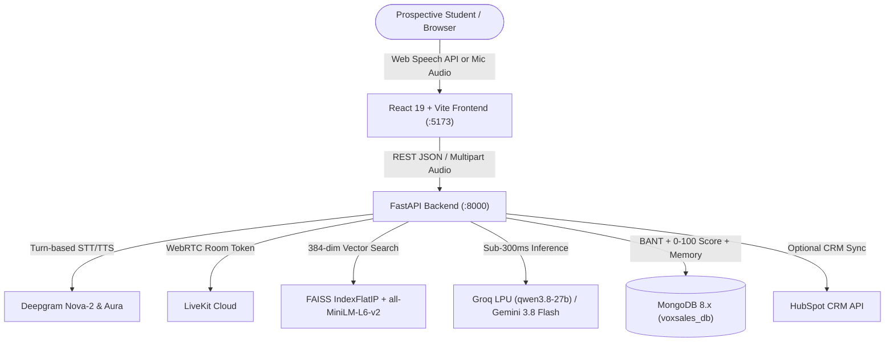
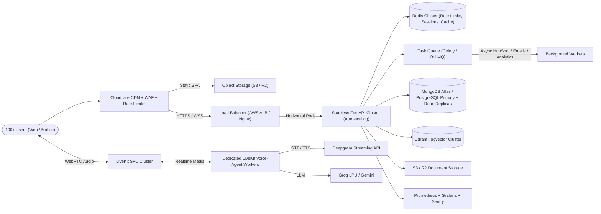

# System Architecture — VoxSales AI + SalesPilot Capabilities

## A. Individual MVP Architecture (Implemented & Running)

The current MVP runs cleanly on a single host or via `docker-compose.yml` (`Dockerfile` + `mongo:8`):

## B. Production-Scale Architecture for 100,000 Users (Proposed)

To scale toward 100,000 registered users and concurrent voice calls without single-node bottlenecks:

### Key Scaling Decisions (100k Users)
- **Stateless API Tier**: Move FAISS local memory index to a shared vector store (Qdrant / pgvector) so multiple FastAPI replicas share uploaded documents.
- **Voice Worker Isolation**: Run LiveKit voice-agent workers on separate auto-scaling compute nodes from REST API pods.
- **Database & Caching**: Connection pooling, compound indexes on `(lead_id, created_at)` and `(slot_date, slot_time)`, plus Redis caching for dashboard aggregations and rate limiting.
- **High Availability**: Multi-AZ database replicas, automated daily snapshots, and circuit breakers around Groq/Gemini/Deepgram.
