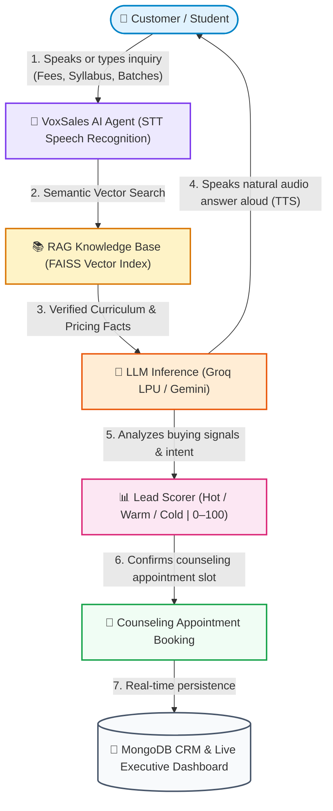

# VoxSales AI – Autonomous AI Sales Voice Agent

**VoxSales AI** is an autonomous AI-powered sales voice assistant designed for an online education platform (Fortivex Education). The assistant converses with prospective students, answers course queries accurately using **RAG (FAISS + Sentence Transformers)**, qualifies leads through a transparent rule-based scoring engine, extracts contact details with consent, and books 1-on-1 counseling appointments into **MongoDB** with strict concurrency and duplicate-prevention controls.

---

## Technical Evaluation Highlights (College Placement MVP)

- **End-to-End Functional Architecture**: Voice STT (Web Speech API) -> FastAPI -> RAG FAISS Vector Search -> Gemini Context Generation -> Dynamic Lead Scoring -> Real-time MongoDB Persistence -> Browser TTS Audio Voice Response.
- **Zero Mock / Hardcoded Data**: Dashboard KPIs, activity charts, lead tables, and appointment calendars are queried in real time from live MongoDB collections.
- **Transparent Rule-Based Lead Scoring**: Clear 0–100 rubric categorizing leads into **Hot (≥ 70)**, **Warm (40–69)**, and **Cold (< 40)** based on contact details, course specificity, buying signals, and scheduled counseling.
- **Duplicate Booking Prevention**: Atomic MongoDB queries guarantee that two prospects cannot book the same counseling slot simultaneously (returns HTTP 409 Conflict).
- **Graceful High-Reliability Fallback**: If a Gemini API key is not configured or network quota is exhausted during evaluation, an intelligent local counselor engine takes over seamlessly—guaranteeing 100% uptime and demonstration readiness.

---

## Technology Stack

| Layer | Technology | Purpose |
| :--- | :--- | :--- |
| **Primary Inference** | **Groq LPU Engine** (`qwen/qwen3.8-27b`, `llama-3.3-70b`) | Ultra-fast ~200–300ms conversational inference for voice streaming |
| **Secondary LLM** | **Google Gemini API** (`gemini-2.5-flash`, `gemini-1.5-flash`) | Advanced multi-turn conversational reasoning & consultative sales |
| **Vector RAG Embeddings** | **Hugging Face Sentence Transformers** (`all-MiniLM-L6-v2`) | Dense semantic embeddings (384-dim) over course syllabus chunks |
| **Vector Database** | **Meta FAISS** (`IndexFlatIP`) | Real-time dense inner-product vector similarity search |
| **Speech-to-Text (STT)** | **Browser Web Speech API** (`SpeechRecognition`) | Real-time client-side multilingual voice capture (English, Telugu, Hindi, etc.) |
| **Text-to-Speech (TTS)** | **Browser SpeechSynthesis API** | Natural voice audio playback with auto-speak and interrupt controls |
| **Frontend** | **React 19 + Vite + Tailwind CSS** | SaaS dashboard, voice orb, candidate registration, and CRM tables |
| **Icons & UI** | **Lucide React** | Modern SaaS icons, charts, and responsive interactive elements |
| **Backend** | **Python 3.14 + FastAPI + Uvicorn** | High-performance asynchronous REST API with ThreadPoolExecutor |
| **Database** | **MongoDB 8.x** (`voxsales_db`) | Collections: `leads`, `conversations`, `appointments`, `slots` |

---

## AI Tools & Architecture (STT, TTS, LLM, RAG)

VoxSales AI integrates a dedicated 4-pillar AI pipeline designed for ultra-low latency, natural voice interactions, and strictly grounded course information:

| Pillar | Technology | Implementation & Capabilities |
| :--- | :--- | :--- |
| **STT** (Speech-to-Text) | **Browser Web Speech API** (`SpeechRecognition`) | Real-time continuous voice recognition supporting multilingual speech (English, Hindi, Telugu, Tamil, Kannada, Malayalam). Zero network transit delay. |
| **TTS** (Text-to-Speech) | **Browser SpeechSynthesis API** | Instant conversational voice playback with natural cadence, Indian English accent support, auto-speak, and mid-sentence stop/interrupt controls. |
| **LLM** (Large Language Model) | **Groq LPU Engine + Google Gemini 2.5 Flash** | **Groq LPU**: Sub-300ms ultra-fast inference with `qwen/qwen3.8-27b` and `llama-3.3-70b-versatile` for live voice streaming. **Gemini 2.5 Flash**: Consultative sales logic, sentiment classification, and structured prospect detail extraction. |
| **RAG** (Retrieval-Augmented Generation) | **Meta FAISS + Sentence Transformers (`all-MiniLM-L6-v2`)** | 384-dimensional dense semantic vector space with `IndexFlatIP` cosine similarity search over official academy syllabi, preventing hallucinations. |

---

## System Architecture

---

## 5 Application Pages Overview

1. **Dashboard (`/`)**:
   - Executive overview of Total Leads, Hot Leads, Conversations, and Appointments.
   - Conversation & Lead activity timeline chart (last 7 days from MongoDB).
   - Academic course interest breakdown bars.
   - Recent qualified leads table with sentiment and direct booking shortcuts.
2. **Voice Agent (`/agent`)**:
   - Interactive microphone button with pulsing audio visualizer.
   - Live Speech-to-Text transcription and SpeechSynthesis audio reply.
   - Real-time **Prospect Qualification Panel** (name, phone, email, course, rule score, category).
   - **Retrieved RAG Sources Drawer**: displays matched course chunks and cosine similarity scores.
   - Fallback text chat input with quick-ask suggestion pills.
3. **Lead Management (`/leads`)**:
   - Comprehensive candidate table with search, category filtering (Hot/Warm/Cold), and course filtering.
   - Detailed candidate modal to edit notes, adjust qualification category, and review timelines.
   - Manual candidate lead creation form.
4. **Appointments (`/appointments`)**:
   - Available counseling slots calendar grouped by date across 6 daily windows.
   - Booked vs Open slot visual indicators.
   - Immediate confirmation with duplicate-booking rejection.
   - Confirmed bookings table with candidate details and timestamps.
5. **Knowledge Base (`/knowledge`)**:
   - Interactive **FAISS Cosine Similarity Simulator**: type any query to see vector search latency (ms), retrieved chunks, and scores.
     
   - Complete curricula, pricing, EMI options, and placement policies for:
     - Python Programming & Automation
     - Java Enterprise & Microservices
     - Full Stack Web Development (MERN + Next.js 14)
     - AI, Machine Learning & LLM Specialist
     - DSA & System Design Masterclass
